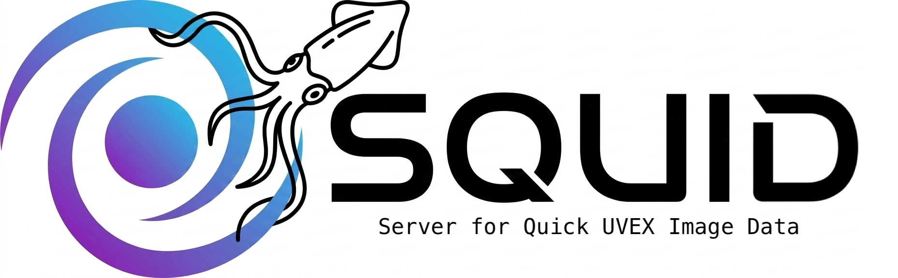

 
<BR CLEAR=”left” /> 

# pySQUID

Control and data-reduction tools for SQUID (Server for Quick UVEX Image Data).

pySQUID is a toolkit for operating a UVEX detector testbed camera and for
turning its raw output (`.bin` acquisitions, raw CMOS FITS frames) into
science-ready FITS files. It installs as a normal Python package and adds
three commands to your environment:

- `pysquid` — drops you into an interactive IPython shell with a `Camera`
  object connected to your testbed
- `bin2fits` — converts raw `.bin` acquisition files (or legacy split TDMS
  files) into FITS images.
- `cds` — digitally CDS-subtracts a raw CMOS MKxNK image (BBx camera)
  with optional frame stacking

## Requirements

- Python 3.8+
- A YAML config file describing your testbed (see [Configuration](#configuration) below)

Runtime dependencies (`numpy`, `astropy`, `PyYAML`, `npTDMS`, `ipython`, `pyvisa`) are
installed automatically by pip.

`cds` additionally uses the separate `catcam` package, but only to process
a series of files generated by `catcam`.

## Getting the code

Clone the repository from GitHub over HTTPS:

```bash
git clone https://github.com/uvex-mission/pySQUID.git
cd pySQUID
```

If you have an SSH key set up with GitHub, you can clone over SSH instead.
If you don't have `git`, you can instead download a zip of the `main`
branch from
[github.com/uvex-mission/pySQUID](https://github.com/uvex-mission/pySQUID)
via Code → Download ZIP, and unzip it.

## Installing into Miniconda3

pySQUID is a normal pip-installable package. The recommended way to use it
is inside its own conda environment, so it and its dependencies stay
isolated from everything else.  First make sure you have Anaconda installed -- we are recommending [Miniconda](https://www.anaconda.com/docs/getting-started/miniconda/install/linux-install) for bifrost accounts.  Then:

```bash
# 1. Create a fresh environment (any Python 3.8+ works; 3.11 shown here)
conda create -n uvexcmos python=3.11

# 2. Activate it
conda activate uvexcmos

# 3. Install pySQUID from the cloned repo (run this from the folder containing pyproject.toml)
pip install .
```

This installs pySQUID and its dependencies into the `uvexcmos` conda
environment and puts `pysquid`, `cds`, and `bin2fits` on `PATH` for as long as
that environment is active.

If you're developing pySQUID itself and want code edits to take effect
immediately without reinstalling, use an editable install instead:

```bash
pip install -e .
```

To leave the environment: `conda deactivate`. To come back to it later:
`conda activate uvexcmos`.

### Getting updates

To pick up the latest changes later, pull from within the repo:

```bash
git pull
```

If you installed with `pip install -e .` (editable), pulled code changes
take effect immediately — no reinstall needed. If you used a regular
`pip install .`, re-run it after pulling to pick up the changes.
Either way, if `pyproject.toml` changed (e.g. a new dependency was added),
re-run `pip install .` (or `pip install -e .`) so pip can install anything
new.

## Configuration

`pysquid` needs a YAML config file describing your testbed. Currently (this will evolve) it must define:

```yaml
OPERATOR: cshapiro   # Who are you?
TESTBED:  testbed1   # Which testbed station?
DETID:    W08D02     # CMOS detector ID
DETTYPE:  NUV        # UVEX detector type (FUV / NUV / LSS / ENG)
DETCTRL:  BB2        # Detector controller type
LEDWAVE:  530        # LED wavelength in nm
```

`TESTBED` is looked up in `pySQUID/testbeds.yaml`, which maps each known
testbed name to its hardware connection settings (`HOST`, `PORT`, and similar
parameters for the devices at the testbed) so you don't need to remember them yourself.

`DETID` is similarly looked up in `pySQUID/devices.yaml`, which maps each
known detector to its bias settings (`V_EXTRA_HI`, `V_EXTRA_LO`, and any
similar per-device parameters). If a `DETID` isn't listed there, the
file's `DEFAULT` entry is used instead and a warning is printed.

For either file, setting `HOST`/`PORT`/`V_EXTRA_HI`/`V_EXTRA_LO` (or any
other looked-up key) directly in your own config file overrides the
testbeds.yaml/devices.yaml value.

## Data Acquisition Usage

Launch an interactive session connected to your camera:

```bash
conda activate uvexcmos  # or your conda env name
pysquid path/to/your_config.yaml
```

This starts IPython with a `camera` (and `cam`) object already created and
connected — try `help(camera)` for the full list of commands, e.g.
`camera.ping()`.

For a worked example of scripting a full test sequence against the
`Camera` class directly (rather than the interactive `pysquid` shell), see
[`pySQUID/lag_example.py`](pySQUID/lag_example.py), which runs an LED-flash
lag-decay test.

## Data Processing Usage

A YAML file with the same basename should be in the same directory as the image data.

Convert a raw .bin acquisition to FITS:

```bash
bin2fits path/to/basename.bin --fast  # Alongside basename.yaml
```
Batch processing:
```bash
bin2fits path/to/basename*.bin --fast  # Processes each matching recording with its own YAML file
bin2fits path/to/basename*.bin --fast  --dryrun  # Summarize expected output only
```
You can take advantage of bifrost's multiple cores:
```bash
for bfile in *.bin; do bin2fits "$bfile" --fast & done  # Using '&' starts the jobs in the background on separate cores
```
Legacy TDMS files are also supported:
```bash
bin2fits path/to/basename.tdms --fast  # Alongside basename.yaml
bin2fits path/to/basename*.tdms --fast  # Automatically groups split TDMS files and YAML files
```

Most users should use `--fast`, which assumes the raw pixel data is organized
the same way in every exposure.  Skip it only if you're working with a file that combines images with
different formats (e.g. some FORTH-scripted tests).

Next, CDS-subtract the CMOS frame data in a raw FITS file:

```bash
cds basename.fits -verbose
```

Run `bin2fits --help` or `cds --help` for the full set of options.

## Understanding CMOS image data

Each FITS image extension represents a pair of reads (Correlated Double Sampling; CDS) through the CMOS detector (possibly a subset of rows).  Within a single scan, the pixel sense nodes are reset (line by line) and their baseline values are read.  Then the pixel transfer gates (TG) are pulsed to allow charge to flow in from the image area, then the new pixel values are read.  This pattern is repeated line by line.  Thus we generate 2 values for each pixel, formatted as a pair of frames whose difference represents the collected charge (in uncalibrated units; ADU).  *This is the basic logic of CDS; the actual BBX operation may include extra steps to mitigate systematic effects.*

The charge collected in the scan pair includes all of the charge integrated on the image area *since the previous scan*.  In particular, the first image extension of a FITS file contains charge collected *since the end of the previous image file*.  If the detector has been sitting idle for some time or has just been reset, the very first image is not very useful and may even be saturated, which takes multiple reads to clear.

Note that the total integration time of an exposure includes the time it takes to scan once through, which is the minimum exposure time.

BBX has an internal clock whose value (in seconds) is saved as TIMMISC_ in the FITS header for each scan.  You can work out the integration time between scans by taking differences of this value; this is done for you in a single FITS file (see TIMEXP_ or EXPTIME) but not across files (EXPTIME for extension 1 is set to -1).  The TIMDELAY header records the requested delay between scans and is useful for sorting data since EXPTIME may have variations on the order of ms that can mess up analysis scripts.

To convert the CDS-subtracted data to units of e-, multiply by the value in GAINFITS.  This is only approximate and does not account for nonlinearity.  Precise results require using the gain (e-/ADU) function from a PTC analysis for the detector.

## Using LED flash

The CMOS transfer gate acts as an electronic shutter.  For many applications (QE, PTC, etc.), you can leave the light source on, allow it to settle, and vary the amount of signal by changing the exposure time.  The timed LED flash `cam.expose_with_flash()` is only needed for measurements such as lag where we need a bright stimulus followed immediately by dark frames.

## License

MIT — see [LICENSE](LICENSE).
